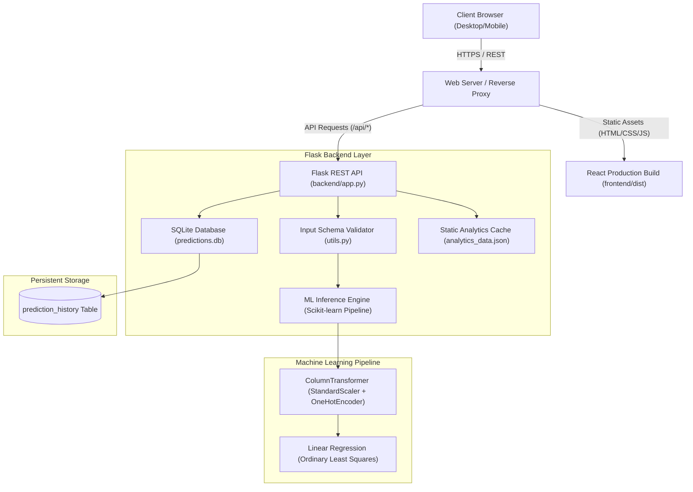
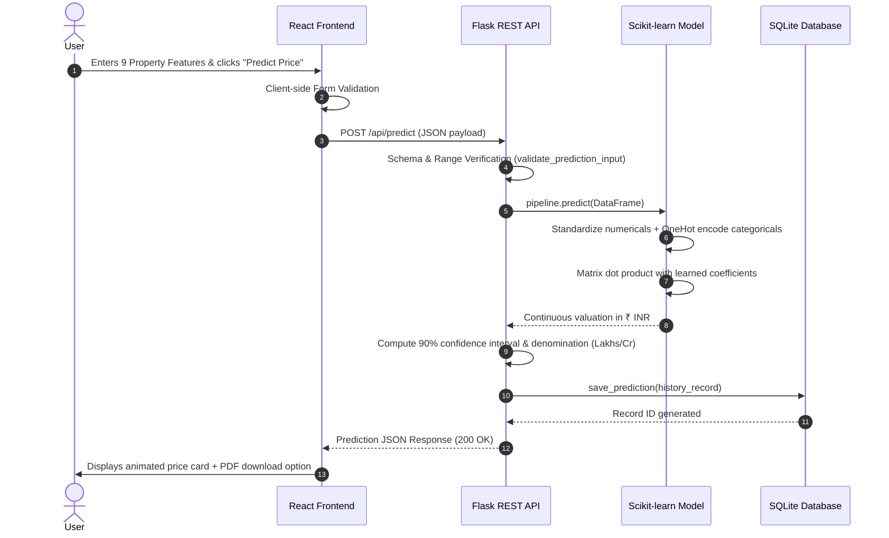

# System Architecture & Technical Design

## 1. High-Level Architecture Overview

**HomePrice AI** is designed around a decoupled, modular microservice architecture combining a high-performance **React Single Page Application (SPA)** with an asynchronous **Python Flask REST microservice** and a serialized **Scikit-learn Machine Learning pipeline**.



---

## 2. Component Breakdown

### A. Frontend Client (`frontend/`)
- **Framework**: React.js 18 with Vite build tooling.
- **State Management**: Reactive React state hooks (`useState`, `useEffect`, `useRef`) with LocalStorage persistence for user themes.
- **Styling**: Tailored Design System with CSS variables supporting instantaneous Light and Dark mode transitions without CSS flicker.
- **Data Visualizations**: `Chart.js` & `react-chartjs-2` with reactive color palette adjustments matching theme modes.
- **Reporting Engine**: `jspdf` & `jspdf-autotable` generating vector-quality PDF Appraisal Certificates directly client-side.

### B. Backend REST API (`backend/app.py`)
- **Server**: Python Flask 3 with WSGI architecture and `Flask-CORS` middleware.
- **Input Sanitization**: Multi-layer numeric bounds checking and string normalization.
- **Database Handler**: Thread-safe SQLite relational persistence for prediction auditing.
- **Static Hosting**: Dual-mode serving capable of running standalone behind Vite or serving the compiled SPA directly on a single port.

### C. Machine Learning Engine (`model/`)
- **Algorithm**: Multiple Linear Regression fitted via Ordinary Least Squares.
- **Pipeline Abstraction**: Encapsulated into a unified `Pipeline` object containing:
  1. `ColumnTransformer` (standardizing continuous features, one-hot encoding discrete features with `handle_unknown='ignore'`).
  2. `LinearRegression` estimator.
- **Artifacts**: Serialized using `joblib` with separate serialized JSON payloads for feature importances and dataset analytics.

---

## 3. Data Flow Diagram



---

## 4. Relational Database Schema (`backend/predictions.db`)

```sql
CREATE TABLE prediction_history (
    id INTEGER PRIMARY KEY AUTOINCREMENT,
    timestamp TEXT NOT NULL,
    city TEXT NOT NULL,
    area_sqft REAL NOT NULL,
    bhk INTEGER NOT NULL,
    bathrooms INTEGER NOT NULL,
    floors INTEGER NOT NULL,
    property_age INTEGER NOT NULL,
    parking TEXT NOT NULL,
    furnishing TEXT NOT NULL,
    property_type TEXT NOT NULL,
    predicted_price REAL NOT NULL,
    price_lower REAL NOT NULL,
    price_upper REAL NOT NULL,
    formatted_price TEXT NOT NULL
);
```
